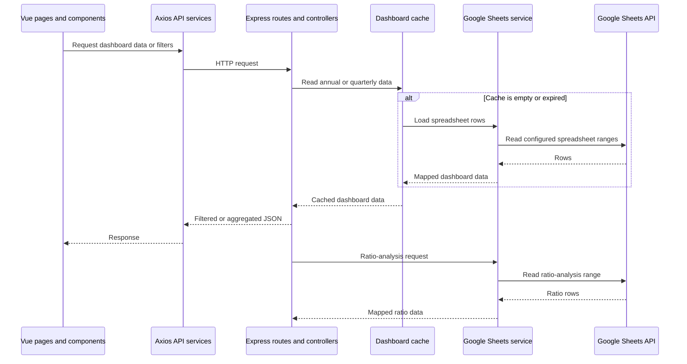

# BPS Dashboard Neraca

A Vue 3 dashboard for viewing Indonesia's sectoral balance-sheet indicators. The frontend consumes a Node.js/Express API; the backend reads the configured Google spreadsheet.

> **Security status:** The API does not currently implement authentication or authorization. Do not use this application to expose data that requires access control until an approved identity provider and server-side authorization policy are in place.

## Features

- Annual and quarterly dashboard summaries, filters, and institutional charts.
- Asset data with filtering, search, and pagination.
- Annual and quarterly time-series views with CSV and PDF export controls.
- Ratio analysis from the configured Google Sheet.
- A landing-page overview of the latest national indicators.

Feature details may change; the Vue views and backend routes are the source of truth.

## Technology

- Node.js and Express 5 for the API.
- Vue 3, Vite, and Tailwind CSS for the frontend.
- Google Sheets API for spreadsheet access.
- ECharts for dashboard visualizations.

## Repository layout

```text
backend/
	api/                 Serverless adapter for dashboard requests
	src/config/          Google Sheets and unit configuration
	src/controllers/     API handlers and data aggregation
	src/mappers/         Spreadsheet-to-dashboard mapping
	src/routes/          Dashboard and ratio-analysis routes
	src/services/        Google Sheets access and dashboard cache
	src/utils/           Spreadsheet row utilities
	test/                Backend regression tests
frontend/
	src/components/      Layout, filters, tables, and charts
	src/services/        Axios API clients
	src/views/           Landing and dashboard pages
	src/utils/           Formatting and statistics helpers
```

## Requirements

- Node.js `20.19+` or `22.12+` (Vite requirement).
- npm.
- Access to the spreadsheet configured for the application.
- A Google service account with read-only access to that spreadsheet.

## Local setup

Install dependencies in each package:

```powershell
npm --prefix backend ci
npm --prefix frontend ci
```

Create `backend/.env` from `backend/.env.example` and configure the values locally:

| Variable | Purpose |
| --- | --- |
| `PORT` | Backend HTTP port; defaults to `3001`. |
| `GOOGLE_PROJECT_ID` | Google Cloud project ID for the service account. |
| `GOOGLE_CLIENT_EMAIL` | Service-account client email. |
| `GOOGLE_PRIVATE_KEY` | Service-account private key. Keep this value server-side. |
| `GOOGLE_SHEET_ID` | Spreadsheet ID read by the backend. |
| `FRONTEND_URL` | Allowed frontend origin, especially for production CORS. |

The frontend reads `VITE_API_BASE_URL`. `frontend/.env.example` uses `http://localhost:3001/api/dashboard` for local development. `VITE_` values are compiled into the browser bundle and must never contain secrets.

For local development, `backend/src/config/googleSheets.js` falls back to `backend/google-service-account.json` when the environment credentials are incomplete. This file is ignored by Git. Production requires `GOOGLE_PROJECT_ID`, `GOOGLE_CLIENT_EMAIL`, and `GOOGLE_PRIVATE_KEY` in the backend environment.

Start the backend and frontend in separate terminals:

```powershell
npm run dev:backend
npm run dev:frontend
```

The equivalent package commands are `npm --prefix backend run dev` and `npm --prefix frontend run dev`. By default, the backend listens on `http://localhost:3001` and Vite serves the frontend at `http://localhost:5173`.

## Data flow



Annual and quarterly dashboard data are cached in memory by the backend. Ratio analysis reads its configured sheet through the Google Sheets service and is not stored in that dashboard cache.

## API routes

The following routes are registered by the current Express application:

| Method | Path | Purpose |
| --- | --- | --- |
| `GET` | `/api/health` | API health response. |
| `GET` | `/api/dashboard/tahunan` | Annual preview (first 20 rows). |
| `GET` | `/api/dashboard/triwulanan` | Quarterly preview (first 20 rows). |
| `GET` | `/api/dashboard/summary/tahunan` | Annual summary. |
| `GET` | `/api/dashboard/summary/triwulanan` | Quarterly summary. |
| `GET` | `/api/dashboard/filters/tahunan` | Annual dashboard filter options. |
| `GET` | `/api/dashboard/filters/triwulanan` | Quarterly dashboard filter options. |
| `GET` | `/api/dashboard/timeseries/tahunan` | Annual time-series data. |
| `GET` | `/api/dashboard/timeseries/triwulanan` | Quarterly time-series data. |
| `GET` | `/api/dashboard/overview` | Latest landing-page indicators. |
| `GET` | `/api/dashboard/institusi/tahunan` | Annual institution options. |
| `GET` | `/api/dashboard/asset/tahunan` | Paginated annual asset data. |
| `GET` | `/api/dashboard/asset/triwulanan` | Paginated quarterly asset data. |
| `GET` | `/api/dashboard/asset/filters/tahunan` | Annual asset filter options. |
| `GET` | `/api/dashboard/asset/filters/triwulanan` | Quarterly asset filter options. |
| `GET` | `/api/dashboard/cache` | In-memory cache metadata. |
| `POST` | `/api/dashboard/cache/refresh` | Clears and reloads annual and quarterly caches. |
| `GET` | `/api/analisis-rasio` | Ratio-analysis data. |

Query filters and pagination are not user authorization controls. All listed data routes are currently accessible without authentication.

## Tests and build

```powershell
npm test
npm run build
```

`npm test` runs the backend Node.js test suite. `npm run build` builds the frontend into `frontend/dist`. The frontend package currently has no test or lint script.

## Deployment notes

The backend can be started with `npm --prefix backend start`. Configure `PORT` and the required Google credentials in the hosting environment. Build the frontend with `npm run build` and serve `frontend/dist` using the approved hosting platform. Set `VITE_API_BASE_URL` to the deployed API base URL when building the frontend; it is a public client-side URL, not a secret.

The backend uses Vercel's Express framework support to serve the Express application and its `/api` routes. Configure the backend project root directory as `backend` and the frontend project root directory as `frontend`. Verify routing, environment variables, HTTPS, and allowed origins with the office infrastructure team before deployment.

## Security and publication

- The backend currently has **no authentication or authorization**. Data endpoints can be called directly, and query filters do not restrict data by user. This README does not claim the application is secure for sensitive data or production-ready.
- CORS is not authentication. Production allows the configured `FRONTEND_URL`; localhost origins are enabled only outside production. `/api` responses use `Cache-Control: no-store`.
- Google credentials must remain in the backend environment or local ignored service-account file. Do not commit `.env` files, private keys, tokens, service-account JSON, or spreadsheet data.
- The checked local service-account file is ignored and was not found in the Git history inspected during this review. This does not establish whether credentials were shared elsewhere; rotate them if exposure is suspected.
- Production build inspection found no source maps and no checked credential markers. Data delivered to a browser is visible to that browser's user.
- The project name and BPS branding appear in this README. Obtain the appropriate BPS approval before publishing it to a public repository. Confirm data classification and spreadsheet access policy with the data owner before any deployment.

No hosting provider, public deployment URL, license, or public repository status is asserted here because none was verified in the repository configuration.