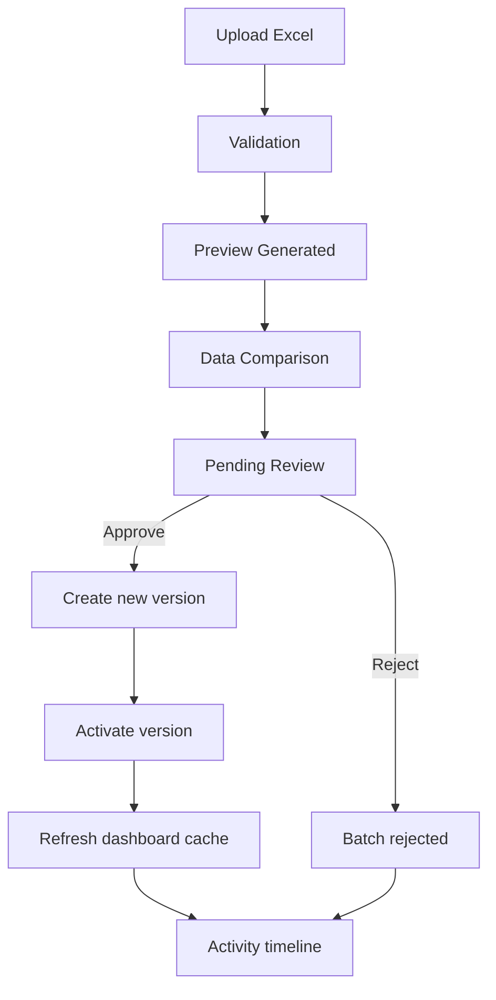

# Data Management Workflow

## Overview

This workflow supports the business process:

Upload Excel -> Preview -> Validation -> Comparison -> Review -> Accept / Reject -> Version activation -> Cache refresh -> Audit trail.

The system is designed to keep active data protected until a reviewer explicitly confirms a batch. Staging rows are isolated from main tables until approval, and all lifecycle events are preserved in an append-only audit trail.

## Lifecycle diagram



## Batch lifecycle status

The implemented status model follows the actual PostgreSQL schema and remains additive-safe:

- uploaded
- processing
- previewed
- confirmed
- cancelled
- failed
- expired

Additional operational interpretation is derived from the review queue and audit log, without changing legacy data or the protected historical records.

## Workflow architecture

### Frontend

The management UI is active in:

- [frontend/src/views/DataManagementView.vue](../frontend/src/views/DataManagementView.vue)
- [frontend/src/services/dataManagementApi.js](../frontend/src/services/dataManagementApi.js)
- [frontend/src/components/data-management/VersionComparisonPanel.vue](../frontend/src/components/data-management/VersionComparisonPanel.vue)
- [frontend/src/router.js](../frontend/src/router.js)

The frontend provides:

- overview dashboard
- upload wizard
- queue review
- batch detail
- version history and restore actions
- audit timeline

### Backend

The core logic is implemented in:

- [backend/src/controllers/dataImportController.js](../backend/src/controllers/dataImportController.js)
- [backend/src/controllers/dataManagementController.js](../backend/src/controllers/dataManagementController.js)
- [backend/src/routes/dataImportRoutes.js](../backend/src/routes/dataImportRoutes.js)

### Database

The applied schema contract remains:

- [backend/database/migrations/005_create_excel_import_versioning.sql](../backend/database/migrations/005_create_excel_import_versioning.sql)

An additive integrity migration is prepared but intentionally not applied to
the primary local database:

- [backend/database/migrations/006_enforce_versioned_data_integrity.sql](../backend/database/migrations/006_enforce_versioned_data_integrity.sql)

The schema covers:

- data_import_batches
- staging_excel_rows
- data_period_versions
- data_change_events
- characteristic_data and related core tables

## Preview and validation flow

### Upload

The preview route accepts multipart Excel files with a strict max size of 15 MB and validates the .xlsx extension.

### Validation rules

The Excel preview process keeps the intended checks from the existing implementation:

- dataset-specific header set: nine characteristic columns or six ratio columns
- correct worksheet
- annual or quarterly period validation, including `YYYY/Qn` in `TAHUN`
- sector alias handling
- numeric parsing and warning classification
- formula and blank row detection
- duplicate business-key detection
- invalid row tracking
- preview sample limit
- maximum row guard of 50,000 rows

### Security and state handling

- preview tokens are stored as a SHA-256 hash
- tokens expire after the configured preview lifetime
- stale previews are marked expired before approval can proceed
- batches cannot be confirmed if the validation stack no longer matches the stored preview state

## Comparison logic

The comparison process compares incoming staged data against the exact active
version captured when preview was created. Approval is blocked if that version
or its activation timestamp changed while the reviewer was deciding.

Rules:

- characteristic key: dataset, sector, year, quarter, side, balance type, code,
    detail, and balance detail; `KONSEP` is reported as metadata, not used to hide
    a changed value
- ratio key: sector, year, quarter, ratio type, code, and detail
- same key and numeric value => unchanged
- same key with changed number => increased or decreased, with exact decimal
    delta and decimal-safe percentage; zero old value has no percentage
- null to numeric => newly filled; numeric to null => newly emptied
- only in new snapshot => added; only in old snapshot => removed

Duplicate incoming business keys invalidate all colliding staging rows; no
comparison or approval is allowed when a record identity is ambiguous. The
comparison uses the shared key utility and never matches by Excel row number.

Comparisons are paginated in the backend and shown both in pending review and
historical version detail. Data values remain in PostgreSQL NUMERIC columns.

## Snapshot mode

The implemented import mode is **Replace Period**. Each accepted workbook is a
complete snapshot: every valid staged record is inserted into a new version,
including unchanged records. Records absent from the new export are not copied
to that new version, but remain in the prior version. Merge/Upsert is not
implemented and must not be used for partial workbooks.

## Approval flow

A batch in previewed state can only be confirmed when all of the following are true:

1. the batch still exists and is pending approval
2. the preview token is valid and unexpired
3. the batch is still in previewed status
4. staging rows still validate as expected
5. the active version has not changed in a way that invalidates the comparison
6. staged business keys are unique and the comparison is not ambiguous
7. a PostgreSQL transaction can complete the version activation without partial updates

The confirmation path does the following in a single transaction:

- locks the target period
- marks the prior active version as superseded
- creates a new data_period_versions record
- inserts the approved staged rows into the current dataset tables
- marks the import batch as confirmed
- emits an audit event
- refreshes the dashboard cache after commit

## Rejection flow

The rejection flow is intentionally conservative:

- the batch is changed to cancelled or equivalent terminal state, while preserving history
- staging rows are removed from active workflow state
- the preview is no longer usable
- no main-table data is changed
- the rejection reason is stored
- the reason is required before rejection/cancellation can be submitted
- the activity is emitted to the audit trail

This matches the requirement that previewed records disappear from the active review queue while their historical trace remains available.

## Versioning and restore

Version management includes:

- list versions
- view version detail
- restore a prior version
- soft delete a version
- restore a deleted version

The version logic uses the same transaction safety approach as approval: the current active version is replaced only after a successful commit and the event is recorded in data_change_events.

## Audit trail

Audit events are stored as append-only records in the data_change_events table. Relevant events include:

- import_previewed
- import_confirmed
- import_cancelled
- version activated and replaced events
- restore and delete events
- cache refresh completion results

The UI exposes the feed via the management audit endpoint and aggregates data by batch, dataset, period, and version.

## Cache refresh

The refresh logic is intentionally separated from the main commit:

- database transaction commits first
- dashboard cache refresh is retried after commit
- a failure is recorded as pending instead of rolling back the import result
- retry API is available through the management cache endpoint

## API surface

Main endpoints:

| Method | Route | Purpose |
| --- | --- | --- |
| GET | /api/data-import/management/summary | summary and dataset status |
| GET | /api/data-import/management/batches | list import batches |
| GET | /api/data-import/management/batches/:batchId | batch detail + validation counts |
| POST | /api/data-import/management/batches/:batchId/confirm | confirm approved preview |
| POST | /api/data-import/management/batches/:batchId/cancel | cancel / reject preview |
| GET | /api/data-import/management/versions | list data versions |
| GET | /api/data-import/management/versions/:versionId | version detail |
| POST | /api/data-import/management/versions/:versionId/restore | restore historical version |
| POST | /api/data-import/management/versions/:versionId/delete | soft delete version |
| GET | /api/data-import/management/audit | audit timeline |
| POST | /api/data-import/management/cache/retry | retry cache refresh |
| GET | /api/data-import/templates/:datasetKey?tahun=YYYY&quarter=1-4 | download a dataset-specific template |
| POST | /api/data-import/preview?dataset=:datasetKey&tahun=YYYY&quarter=1-4&mode=replace_period | upload and preview Excel |
| GET | /api/data-import/management/batches/:batchId?comparison_page=1 | batch validation and pending value comparison |
| GET | /api/data-import/management/versions/:versionId?comparison_page=1 | historical value comparison |

Excel import supports `tahunan`, `triwulanan_1`, `triwulanan_2`, and
`analisis_rasio` (annual or quarterly). Banding Makro remains blocked until its
Excel mapping to `macro_transactions` is verified. The existing `/database`
page reads dashboard data through active-version-backed services.

## Schema and compatibility notes

This workflow is intentionally additive and backward compatible with the existing versioning schema:

- no destructive reset or TRUNCATE is used
- protected historical data remains intact
- the active-period model remains version-based; runtime queries join the
    `active` version for each dataset and period
- migration 005 is not re-run
- migration 006 is not applied during this work; it adds one-active-version and
    per-snapshot business-key unique indexes after read-only preflight
- any status or workflow control remains consistent with the current database contract

## Testing instructions

Run from the project root:

```bash
cd backend
node --test
```

Then validate the production frontend bundle:

```bash
cd frontend
npm run build
```

Annual, quarterly characteristic, and annual/quarterly ratio workbooks use the database-backed versioning process. Banding Makro remains read-only from its verified PostgreSQL-backed service; Excel import is not enabled for that dataset.

## Verification status

The local database was inspected in a read-only transaction. Counts were
139,227 characteristic rows, 2,840 ratio rows, and 29 macro rows; no period had
multiple active versions, and the candidate characteristic/ratio business keys
had no duplicates. Batches 18 and 19 remained `cancelled` with zero staging
rows; no writes were performed.

The repository is validated with mocked controller tests and a production
build. No isolated writable PostgreSQL test database or browser automation run
was available for this pass:

- backend unit/controller tests: PASS
- frontend production build: PASS
- PostgreSQL mutation/integration tests: NOT TESTED
- browser automation: NOT TESTED in this environment
